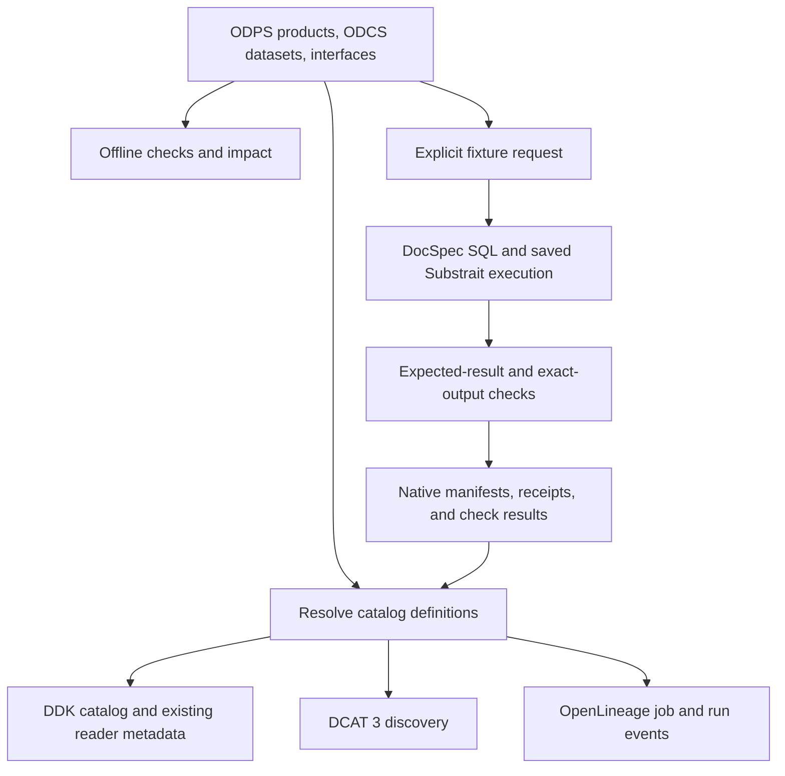
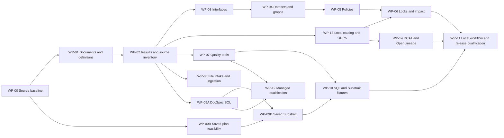

# Data Design Kit — Implementation Plan

**Updated November 7, 2026. Status: integrated SDK3 passed all 13 local installed profiles and 266 required case/profile checks against the current DocSpec executable. All 703 installed tests passed with zero skips. Both full application replacements remain incomplete. Publication awaits a destination.**

## 1. Delivery decision

Build an independently authored Python checker and catalog generator. Use one set of maintained definitions for catalog discovery and evidence. Attach observed versions, releases, runs, and check results from their native owners. Under [ADR-015](architecture-decisions.md#adr-015--keep-ddk-to-the-evidence-bound-catalog), transformations are SQL files that run as DocSpec job steps. The interface, design-graph, dataset-compatibility, impact, lock, file-intake, saved-plan, fixture, bundle and binding requirements and the `build` and `test` commands are frozen at their current qualification: WP-03, WP-08 and the frozen requirements in WP-04, WP-06, WP-09B and WP-10 take no new work. The catalog lock stays live under DDK-CATALOG-007.

The first DDK product release includes ODPS product definitions, ODCS dataset definitions, DCAT 3 discovery, OpenLineage job and run records, and saved Substrait execution through DocSpec. It also qualifies SQL execution, independently specified fixtures, and supported ODCS checks. The offline checker remains independently installable and usable. Data Contract CLI, Frictionless, dlt, pytest, and the DocSpec profiles retain distinct capability boundaries.

The first connected workflow uses independently authored local commerce inputs, real staging and execution receipts, exact-output quality checks, and a generated catalog that binds a checked query. A companion nested-data fixture checks scoped relationships. A separate typed managed operation qualifies native quality acceptance and recovery. Project pilots are outside the build scope. This plan implements the [engineering specification](specification.md). The [work-package registry](../implementation/work-packages.json) and [conformance cases](../conformance/cases.json) track the normative requirements.

The adopted [build strategy without pilots](build-strategy-without-pilots.md) organizes four parallel tracks. [Deferred pilot notes](pilot-adoption-notes.md) preserve that original scope. The separately requested full SpicyRegs and congressional-tech replacements are greenfield: their producers and readers update together. Both remain incomplete. Their [shared runtime plan](replacement-runtime-plan.md) identifies the extensions, owners, dependency order, and independent acceptance cases. Local application work can use the qualified [integrated SDK3 package](local-release-integrated-3.md); its native claims retain the exact tested executable and dependency tuple. Application inputs and publication still need their own acceptance.

## 2. Completed local deliverables

The table preserves the `0.1.0-dev.2` installed capture and portable acceptance. The newer [integrated SDK3 package](local-release-integrated-3.md) separately passes all 13 installed profiles; it does not replace the dev2 portable archive. WP-11's local qualification is complete. Publication remains pending until a destination is selected. The [dev1 capture](local-release-dev1.md) retains its earlier identities and results separately.

| Track | Implemented | Qualification evidence |
| --- | --- | --- |
| Offline core and impact | Strict document and definition loading, interface and dataset checks, graphs, policies, locks, and catalog-aware impact | Named cases passed; isolated core installation passed; small-fixture resource measurements retained |
| Catalog and interchange | Open Data Product Standard (ODPS) port resolution, local owner receipts, scoped identities, atomic refresh, Data Catalog Vocabulary (DCAT) discovery, OpenLineage, and exact-version query binding | Independent readers and the connected workflow passed against the exact checked saved-plan output |
| Native execution and quality | Bounded DocSpec SQL and saved Substrait execution, Data Contract CLI checks, Frictionless CSV validation, dlt Parquet staging, and one typed local managed Build workflow | Supported operations, required failures, uncertainty, exact-native acceptance, and reconciliation passed on the recorded tool versions |
| Local release | Installable package, portable macOS arm64 archive, dependency locks, notices, software bills of materials, exact capability manifests, and retained evidence | All 226 installed tests passed; 154 case/profile combinations qualified; repeat wheels were identical; portable checks and four fresh connected-workflow cases passed |

The [local release](local-release.md) identifies the tested source and artifacts. The [implementation status](implementation-status.md) describes the supported boundaries. The [verification record](verification.md) separates document checks, captured execution, historical evidence relocation, and fresh native replay. Publication, additional engines, and standalone plan validation remain separate work. The work packages below preserve the delivery requirements; their local completion status is recorded in the registry.

## 3. Implementation architecture

Use Python 3.12 as the initial development baseline; add supported Python versions through tested release matrices. Start with the standard library, `jsonschema`, and `referencing` for the core. JSON is mandatory. Add optional YAML only with a parser configuration that meets the restricted YAML requirements.

| Planned boundary | Owns | Must remain outside it |
| --- | --- | --- |
| Domain: products, datasets, designs, policies, impact, results | Typed declarations, scoped relationships, exact references, compatibility rules, result reduction | Native implementation types, runtime selection, transport |
| Application: project checks, catalog assembly, impact, preparation, tests | Resolve definitions, connect native evidence, and generate requested outputs | Native lifecycle state, retention or selection authority |
| Document and catalog adapters | Parsing, local native metadata, pinned schemas, DCAT and OpenLineage mapping, and reader outputs | Runtime imports and network resolution during core checks |
| Execution and quality adapters | DocSpec/native-tool mapping, structured transport, evidence translation | Duplicated domain policy or native durable phases |
| CLI and composition root | Arguments, output, explicit service construction | Compatibility logic and ambient adapter activation |

Use simple typed records and explicit constructor/function arguments. Domain/application boundaries are required; empty package hierarchies and generic dependency containers are not. A CLI composition root and a library composition root may inject the same adapters. Core invokes neither a runtime nor quality service.

The initial execution use cases justify `PlanService`, `JobExecutor`, and `QualityEvaluator`. Add `DatasetRuntime` with the first managed workflow. One DocSpec adapter may implement multiple ports. Begin with structured subprocess requests/responses; add only missing DocSpec preparation and receipt support. A server or Python binding needs a demonstrated additional use case. The [runtime integration design](runtime-integration.md) specifies inputs, outputs, checks, and ownership.

### 3.1 Data movement

Ordinary catalog builds read metadata. A requested fixture test reads its pinned inputs and executes in an isolated local context. Frictionless checks a selected file boundary, and dlt supplies staging receipts for configured ingestion workflows. DocSpec resolves native versions and preserves their schema and field identity. Production publishers supply selected release records.

Implementation declarations identify format, dialect, and semantics. Bindings select the runtime, execution mode, connections, and limits. Retain native computation and qualification keys separately from full provenance. Reuse qualifying evidence only when its target, rule, evaluator, scope, and custody assumptions still apply.

### 3.2 Error flow

Each check consumes validated prerequisites and returns a typed result. A failed prerequisite makes dependent instances `not_run`, with the original failure retained. The final reducer owns the decision and exit code. Human rendering is a view over those records. Severity filters never determine correctness. Runtime execution and selection have separate outcomes. A timeout can make report completion an operational error while native work remains unknown or continues. Preserve the original managed operation ID and reconcile through DocSpec; never create a replacement automatically. Returned bounded-job partial outputs do not imply durable process-loss recovery.

## 4. Dependency order and milestones

The diagram shows required dependencies, with redundant transitive edges omitted. Document loading and saved-plan feasibility start independently after WP-00. The shared foundation supplies exact source inventories, resolved definitions, and result records before adapter integration. Execution, quality, ingestion, and catalog work proceed alongside compatibility and impact analysis. Integrated requests still enforce all applicable prerequisites.

| Milestone | Useful outcome | Exit evidence |
| --- | --- | --- |
| M0 | Pin the source baseline and start the runtime probes | Exact source/dependency identities and bounded saved-plan and native-quality experiments |
| M1 | Establish shared records and usable independent tracks | Strict loader, resolved definitions, check reducer, exact input inventory, and explicit service interfaces |
| M2 | Connect the local commerce workflow | Staged file list feeds SQL and saved Substrait; both match independent rows; output checks and catalog query bind the same exact result |
| M3 | Complete correctness and standards coverage | Impact, scoped/nested relationships, independent DCAT reading, OpenLineage identity, failure and uncertainty cases |
| Release | Qualify the first product profile set | DDK-VERSION-003 profiles, the local demonstration, clean installation, and retained evidence |
| Complete stack | Qualify intake, ingestion, and one managed operation as well | WP-08 and WP-12 evidence including exact-native quality access, guarded selection, rule-only reuse, and lost-response recovery |

WP-11 retains the first-release profiles in DDK-VERSION-003. Completing this build strategy also requires WP-08 and WP-12; their capability claims remain separately evidenced. Standalone Substrait validity and additional-engine portability require their own tested combinations. No project pilot is a build or release prerequisite.

## 5. Work packages

### WP-00 — Public-source baseline

**Dependencies:** none. **Primary owner:** DDK integration. **Output:** pinned source and schema evidence for offline development.

1. Review [provenance](../PROVENANCE.md), keep independent fixtures, and confirm licenses and required notices for the exact baseline artifacts.
2. Record the published and development revisions in use. Use [GitHub research](github-evidence.json) as a dated lead. Qualify behavior in the work package that uses it.
3. Pin ODCS, ODPS, and OpenLineage schemas. Check the draft examples and parse the DCAT graph with an independent reader.

**Acceptance.** The source inventory identifies exact revisions, digests, and licenses. WP-01 and WP-00B can begin independently. WP-01 owns local-definition resolution and inheritance regressions. WP-07 and WP-08 own their native-tool regressions. WP-09A owns the integrated DocSpec SQL path; WP-09B owns saved-plan integration and qualification.

### WP-00B — Saved-plan feasibility experiment

**Dependencies:** WP-00. **Owners:** DocSpec runtime and DDK integration. **Output:** an early evidence-backed decision on the Rust DataFusion baseline and supported saved-plan operations.

- Run a bounded local experiment alongside early core and catalog development. Use independently authored commerce inputs and expected rows for the read/filter/join/aggregate subset needed by the first release. This experiment requires neither a completed DDK adapter nor the pilot datasets.
- Produce and save binary Substrait bytes, then reload and execute those bytes with explicit bindings through DocSpec's admitted context. Record source and distribution identities, encoded format version, extension definitions and digests, input mappings, and output expectations. Compare direct SQL and saved-plan results independently with the authored rows.
- Exercise decoded-plan function/input restrictions and applicable resource limits. Retain failures, unsupported operations, and unknown results with their scope. Keep compiler success, consumer planning, standalone validity, output inference, and execution evidence separate.
- Decide whether to retain the tested baseline, change it, or revise the proposed operation mapping while preserving the required local workflow. A standalone validator and another engine remain separate experiments.

**Acceptance.** Retained inputs, plan bytes, commands, native results, and dependency identities make the experiment reproducible. The decision names the supported subset and unresolved work. An unsuccessful experiment leaves the saved-plan capability unqualified and identifies what must change before WP-09B can qualify it. WP-09B reuses applicable evidence, integrates the selected path, and verifies the final dependency tuple. This experiment alone does not complete a DDK profile or the release gate.

### WP-01 — Strict documents, source locations, and artifact index

**Dependencies:** WP-00 baseline. **Output:** parsed artifacts and effective local definitions with stable identity, namespace resolution, and source provenance.

- Implement JSON parsing that rejects duplicate keys, non-finite values, and invalid UTF-8. Preserve exact bytes for digests and JSON Pointers for locations.
- Register the draft schemas and pinned ODCS revision in an offline `referencing` registry. Separate Draft 2020-12 validation from the ODCS schema's Draft 2019-09 dialect.
- Validate document shape before constructing typed records. Preserve unknown optional extensions without interpreting them.
- Implement namespace-scoped paths, imported-project traversal, permitted-root checks, dataset-object selection, and identity conflicts. Load each project file once at its shortest import path so aggregator roots and layers that import their neighbours share one namespace; record later paths as import aliases.
- Resolve local ODCS definitions before compatibility or catalog interpretation consumes them. Preserve the pinned upstream precedence and qualify inheritance with independent differential cases. The native CLI resolver imports network-capable helpers and lacks DDK root/read-cache controls, so core uses bounded local metadata resolution; WP-07 owns comparison with the maintained CLI. Keep runtime imports outside core.
- Preserve followed definition bytes, fragments, resolution chains, and key-level inheritance/override provenance. Return effective values alongside original source values; missing or cyclic required definitions fail resolution. Remote links are documentation references unless the document opts into inlining; an opted-in remote definition remains unknown.
- Make limits configurable and preserve partial diagnostics on limit exhaustion.
- Optionally add restricted YAML after JSON behavior is stable. Do not use a parser's default YAML 1.1 boolean or date conversions.

**Acceptance:** all document and reference cases pass, including two imported projects that reuse the alias `orders`, a root-relative reference, a symlink escape, duplicate keys, invalid fragments, and same-version conflicting content. Independent inheritance cases preserve an inherited pattern alongside an inline maximum length and apply the selected resolver's explicit enum precedence. Missing and cyclic definitions block dependent interpretation. A core import must not load a reader, engine, or network client.

### WP-02 — Results, decisions, CLI, and capability discovery

**Dependencies:** WP-01. **Output:** complete machine-readable results and stable command behavior.

- Make the exact source inventory and runtime evidence identities available to all adapter tracks before impact analysis completes.
- Implement result and diagnostic records from the report schema, including independent runtime execution/selection outcomes. Add the application use cases and explicit composition-root injection; domain tests must not import native implementation types.
- Implement one decision reducer for operational errors, required failures, incomplete required checks, and passing selected coverage.
- Build check-instance inventories before optional dispatch, including missing adapters.
- Add the proposed CLI command skeleton, including `catalog`, with correct argument errors, output streams, explicit side-effect boundaries, and atomic writes.
- Discover optional adapter manifests as data. Load executable implementations only for explicitly selected profiles.
- Exercise every decision combination, display filter, and machine-output path with meaningful CLI tests.

**Acceptance:** JSON output is one parseable report; output filters never change exit status; required missing adapters return 2; invalid documents return 1; unreadable required inputs return 3. Placeholder adapter code must return not-run rather than fabricated success.

### WP-03 — Component interfaces and bounded parameter reasoning

**Dependencies:** WP-02. **Output:** implementation-free checks for named calls and arguments.

- Validate object parameter schemas and tagged literal/reference arguments.
- Validate complete literal argument objects using upstream JSON Schema behavior, including cross-property constraints.
- Implement the documented primitive containment subset using exact numeric bounds and explicit boolean handling.
- Return unknown for unsupported schema reasoning; add per-property and whole-object instances so correlated constraints remain visible.
- Check named inputs and outputs while retaining related declaration locations.
- Validate artifact format, dialect, and semantic-profile declarations while keeping implementations opaque during core validation. Keep runtime placement and limits in binding/caller settings.

**Acceptance:** a shared reader interface can be checked with no module present. The same call engine handles readers and transformations. Missing required arguments, unknown arguments, literal objects containing reserved-looking text, symbolic enums and bounds, and unsupported conditional schemas all have explicit expected results.

### WP-04 — Dataset compatibility, design graphs, and exports

**Dependencies:** WP-03. **Output:** declared input/output relationships for flat ODCS datasets.

- Normalize the selected ODCS object's effective values from WP-01 into field records while retaining original source values, order, and definition provenance.
- Implement field presence, logical scalar relationships, required/nullability behavior, and enum-value containment.
- Record declared uniqueness and row identity as assumptions. Do not infer join cardinality from column names.
- Build indexed step relationships; use deterministic topological ordering and detect self-cycles and larger cycles.
- Check every named export, including direct source exports and multiple component outputs.
- Represent unsupported nested or physical-type requirements as unknown, even when the ODCS document itself is valid.

**Acceptance:** multiple independent exports are all checked. Compatibility uses resolved inherited constraints; a failed required definition makes the dependent comparison not-run. An absent column fails even when ODCS `required` is false. Boolean-to-number is rejected. Extra-field behavior differs explicitly between input ports and exports. Positional execution mappings remain separate from logical name comparison.

### WP-05 — Shared definitions, project policies, and provenance

**Dependencies:** WP-04. **Output:** cross-document policy checks and definition-use inventory.

- Use the effective definitions and key-level provenance produced by WP-01 for policy checks and the definition-use inventory.
- Implement fields-exist, row-identity, quality-fields, vocabulary, layer-order, and view-sources rules as small typed checks. Row identity and layer order reuse the catalog's key and product-port resolution rather than second resolvers; row identity accepts the ODCS primary key.
- Inventory unused registered definitions, including definitions carrying quality arrays.
- Preserve SQL and custom rules as declarations. Complete quality dependency metadata can be checked; undeclared SQL dependencies remain unknown.
- Reserve optional CUE integration until actual cross-field policy needs justify another language and runtime dependency.

**Acceptance:** changing one shared property or its quality declaration affects the right loaded consumers. Policy results retain the inherited and overridden values supplied by WP-01. A misleading primary-key claim is never promoted into observed uniqueness.

### WP-06 — Locks, dependency-aware impact, and non-weakening

**Dependencies:** WP-05 and WP-13. **Output:** reproducible checks and catalog-aware change analysis.

- Generate locks from actual source bytes and every followed local reference. Record distribution hashes and source commits for development builds, even if their package version matches a released version. Preserve native input references and runtime-issued computation/qualification keys independently from provenance; do not create a second native phase cache.
- For application replacement, define and verify which dependencies affect computation, qualification and metadata separately from the complete provenance lock. A whole-lock fingerprint refusal alone proves neither data incompatibility nor safe reuse. Preserve existing guards and retained pins until the successor interpretation establishes the relevant obligations.
- Verify locked runs before using caches. Detect a changed transitive definition and a changed resolver or schema revision.
- Compare explicit base and candidate catalogs by identity. Separate content changes, declared version changes, and optionally formatting-only differences.
- Compute affected consumers using the union of base and candidate dependency relationships; removed edges must not hide former consumers.
- Compare selected relationship-profile provenance and assessments as well as declarations. Require metadata and reader checks for affected relationships while preserving unknown domain effects and separate computation obligations.
- Revalidate candidate calls and report paths from changed declarations to affected consumers.
- Apply supported acceptance-direction and output-direction containment. Return unknown for unsupported non-weakening questions.

**Acceptance:** the independent reader-change scenario identifies all loaded consumers and distinguishes affected from broken. Same-version content changes fail the appropriate check. Cross-repository scope is explicit. Cached evidence changes when any relevant dependency changes.

### WP-07 — Data Contract CLI integration

**Dependencies:** WP-02. **Output:** native ODCS lint, version comparison, and actual-data results.

- Prefer a stable public API when sufficient; otherwise use a structured subprocess invocation with captured native evidence.
- Compare the published CLI with GitHub commit `34b12923e0366fa4004c2f90644da41769699e0f`, which includes the inherited-constraint correction. Reuse the resolver identity and inheritance evidence accepted in WP-01; rerun those regressions if the native CLI integration changes that tuple.
- Verify which schema revision the CLI actually uses. Distinguish its native lint result from DDK's pinned-schema result if they differ.
- Preserve producer/consumer perspective for version changes.
- Test final local Parquet or DuckDB output through the supported native backend and preserve unsupported quality-rule outcomes. Implement `QualityEvaluator` with exact dataset identity, resolved rules, required check inventory, evaluator identity, mapping semantics, and native evidence. Probe direct exact-candidate access separately; do not qualify a native gate from file-backed success.
- Evaluate open PRs 1725 and 1726 for exact extra-field/order requirements before considering any duplicate runtime implementation in DDK.

**Acceptance:** native lint/data/version results translate faithfully into DDK evidence. A backend that cannot execute a requested rule does not produce a passed result. No credentials or production location are required for the local conformance example.

### WP-08 — Frictionless files and dlt staging

**Dependencies:** WP-02. **Output:** validated file intake and exact staged-snapshot receipts. This can proceed independently of the SQL/quality demonstration.

- Translate the supported ODCS subset to explicit Table Schema descriptors. Report missing-value, nullability, enum, uniqueness, and physical-type coverage separately.
- Exercise Frictionless's full selected check inventory, including error paths involving misconfigured checks. Open PR 1867 is a specific regression lead.
- Verify composite unique-key behavior under the exact selected commit. Open PR 1827 documents why accepting a descriptor is insufficient evidence of executing that requirement.
- Configure dlt field hints and schema-evolution policy independently. Use local fixture sources and the filesystem/Parquet destination first.
- Record normalization/name mappings, system columns, load identifiers, explicit file lists, and discarded counts when applicable.
- Keep nested Parquet claims disabled until the selected dlt version passes the relevant case; PR 4299 is a future-profile lead.

**Acceptance:** malformed input fails before normal ingestion. A new field under a frozen policy fails in the intended stage. The downstream binder uses exactly the staged files in the receipt. Mapping unsupportedness is visible instead of silently widening the schema.

### WP-09A — DocSpec SQL preparation, jobs, and native bindings

**Dependencies:** WP-02 and WP-00 source baseline. **Owners:** DocSpec for runtime changes; DDK for application ports and translation. **Output:** one explicit, bounded SQL execution path.

- Reshape DocSpec's unreleased public API as needed to support schema-only preparation and machine-readable job receipts. Reuse its maintained DataFusion context, function/input checks, budgets, and native readers.
- Implement `PlanService` and `JobExecutor`; do not leak DataFusion frames, catalogs, or DocSpec domain types into DDK's domain.
- Start with one SQL component, flat schemas, named inputs, explicit parameter binding, and independently authored expected outputs. A Substrait intermediate is optional.
- Encode authored fixture rows as bounded, explicitly schematized JSON Lines for the existing DocSpec input path. Direct CSV execution is not established by current `JobSpec`; qualify an explicit conversion/read path or report it unsupported. Keep the commerce CSV intake example distinct from the first fixture execution.
- Support discriminated file/native bindings. Validate native references using their runtime scheme and preserve complete dataset interpretation, native field IDs, names/order/types, native digest algorithms, and protection lifetime.
- Return observed partial outputs on ordinary job failure. Distinguish process loss and unknown outcome from a known failure; do not advertise durable tracking for current ordinary jobs.
- Produce a bundle whose exports identify implementation format and semantics, with source inventories, exact bindings, generated jobs if any, mapping coverage, and unfulfilled obligations.

**Acceptance:** preparation reads no production rows; SQL fixtures run through DocSpec; exact native reads survive a change to latest; wrong algorithms, missing versions, and ambiguous group mappings are refused. A second-output failure preserves the first output's identity. Source byte hashes and native identities remain distinct. No DDK native phase store exists.

### WP-09B — Saved Substrait through DocSpec

**Dependencies:** WP-09A and WP-00B. **Owners:** DocSpec for format/runtime support and DDK for capability and evidence mapping. **Output:** the first release saved-plan capability. Use the baseline decision and retained experiment from WP-00B; resolve its outstanding issues and qualify the integrated path on the final dependency tuple. Probe a standalone validator or another engine only for its separate profile.

- Add a Substrait representation through the same admitted DocSpec context used for SQL; qualify any dependency/API changes together.
- Save binary bytes, encoded format version, extension definitions and algorithm-tagged digests, producer and consumer identities, and a readable upstream-generated view.
- Consume those bytes with exact named bindings before output inference or execution. Apply normalized-plan function/input restrictions and equivalent resource checks after decoding.
- Compare names, nullability, logical/physical types, and ordering with the expected ODCS object under the selected mapping profile.
- Run a compatible standalone validator separately. Preserve unknown validity, unsupported operations, and absent compatible validators.
- Add a second-engine experiment only after the selected tuple passes independent business expectations. Do not build a new validator or silently recompile SQL to rescue portability.

**Acceptance:** saved bytes support the selected read/filter/join/aggregate subset; unknown functions and unauthorized reads cannot bypass guards; memory/spill/concurrency limits remain applicable. Compilation, consumer planning, standard validity, output inference, and execution remain separate. Direct SQL tests and offline checks can run before this package completes. First product release acceptance requires it.

### WP-10 — Fixture tests, native output checks, and portability

**Dependencies:** WP-07, WP-09A, and WP-09B. **Output:** reproducible SQL and saved Substrait tests with exact-output quality evidence. WP-08 contributes optional file intake and ingestion cases.

- Use pytest to load independently specified cases, execute the identified SQL artifact through DocSpec, and compare unordered multisets by default. The required Substrait cases consume saved bytes and use the same independent expected rows as the SQL tests.
- Include duplicate input keys, unmatched joins, null values, empty input, integer money arithmetic, date boundaries, and explicit type errors.
- Verify each engine against expected business results; compare engines only after those checks.
- Run native ODCS output checks on the candidate snapshot. Record evidence once and reuse it only with identical input and tool fingerprints.
- Add DuckDB's Substrait extension as a second engine after its tuple passes the selected operations. Leave portability unknown or unavailable if it does not.
- Cancel the caller wait or request native cancellation as supported, preserve original native IDs and uncertain outcomes, retain bounded failure evidence, and clean only temporary data owned by the runner. Never remove native protected candidates through local fixture cleanup.

**Acceptance:** actual fixture totals match the authored expectations; repeated rows remain significant; wrong-but-well-typed joins fail result tests. The Substrait result is established by executing the saved plan. A report can show core passed while an explicitly required portability check remains incomplete.

### WP-11 — Release qualification and handoff

**Dependencies:** WP-06, WP-10, and WP-14. **Output:** reproducible first product release with the complete DDK-VERSION-003 profile set. WP-08 and WP-12 qualify separate claims.

**Current result:** integrated SDK3 passes all 13 local installed profiles and 266 required case/profile checks, including its connected workflow and managed profile. All 703 fresh installed tests passed with zero skips. Portable installation, relocation and archive verification retain their separate `0.1.0-dev.2` result. Publication awaits a destination. These results qualify the recorded source and native macOS arm64 tuple; the SQL-only executable's separate feature-specific software bill of materials remains `not_run`.

- Package the offline checker and adapters with explicit installation and invocation boundaries. Verify the core-only installation and the complete first release workflow.
- Run the required conformance and CLI cases across supported platforms. Test paths outside the source checkout.
- Publish the supported profiles, dependency lock, upstream references, notices, and software bill of materials.
- Retain independent results for ODPS resolution, DCAT access links, OpenLineage design and observed run records, SQL and saved Substrait execution, and output qualification.
- Measure representative loading, impact, and metadata refresh behavior. Record the reused evidence and payload reads.
- Use the owner-controlled release workflow after the acceptance evidence is complete.

**Acceptance:** the local workflow meets DDK-TEST-004: a consumer discovers the commerce product, chooses the exact checked saved-plan output, runs a bound query, and sees applicable evidence and limitations. Maintainers can reproduce the test and impact reports. Each profile claim names its tested dependency tuple.

### WP-12 — Managed candidates and accepted quality gates

**Dependencies:** WP-07 and WP-09A; exact-native quality access must pass before a native quality-gate claim. **Owners:** DocSpec for lifecycle changes; DDK for `DatasetRuntime`, rule requests, and receipt translation. **Output:** one qualified managed operation/backend family.

- Choose a concrete existing typed operation family and backend. Arbitrary managed SQL and automatic incremental planning are separate future designs.
- Expose native prepare/inspect/accept-qualification/select/reconcile responsibilities while keeping one lifecycle, phase-reuse authority, protection inventory, and selection owner.
- Capture stable operation ID, request identity, required rule-set artifact, and policy preconditions before submission. Preserve them on timeout and cold restart.
- Retain candidates while the configured evaluator reads the exact protected version. Accept evidence only for matching candidate, complete rules, evaluator, semantics, and required-check coverage.
- Check accepted evidence with authority conditions in guarded selection, including each supported selection branch. Missing/unknown/failed required checks and wrong-candidate evidence cannot select.
- A changed qualification request may reuse native computed values. Keep computation keys, qualification keys, and full provenance distinct. Do not mutate the original request silently.
- Record accepted native qualification identity, known outputs, execution outcome, selection outcome, and reconciliation capability. Reconcile lost responses under the original native operation ID.

**Replacement extension:** the SDK3 local managed qualification includes retained-job native SQL reports and accepted producer prerequisites. Complete application report inventories and production inputs still require application acceptance. Retain the supported DCC verifier and the concrete native report verifier. Bind original rules, trusted evaluator/version and semantics, exact candidate/view sets, completed execution and applicable reads, and every required outcome. Native rules need not be re-executed through DCC materialization to qualify them. This adds no generic passed-boolean acceptance and no DCC semantic-equivalence claim. The [shared runtime plan](replacement-runtime-plan.md) records the separate implementation and acceptance work.

**Acceptance:** rule-only change performs no new computation; stale or incomplete qualification blocks selection; concurrent authority changes cannot select stale candidates; lost acknowledgment returns the original outcome without repeating completed work. File-backed quality results alone do not qualify native access. Report the managed profile as unqualified until exact-native evidence acceptance passes. Its release evidence is separate from bounded job evidence.

### WP-13 — Product catalog and native metadata

**Dependencies:** WP-02. **Owners:** DDK and project metadata owners. **Output:** ODPS-backed catalog and its exact input inventory.

- Resolve product ports to registered ODCS objects and validate identities, relationships, and recipes. Support definition-only discovery and relocatable companion recipes.
- Expose the admitted catalog, audience-safe report, and exact companion bytes from the same assembly. Preserve incomplete qualification and generate complete controls only for passing results. Support explicitly scoped definition and extension disclosure without reconstructing application metadata from source files.
- Implement an explicitly selected local metadata adapter that reads actual staging, DocSpec execution, and quality receipts from the reference workflow. Preserve each observed fact's owner, exact identity, coverage, and custody. Illustrative example receipts qualify shape tests only.
- Add the replacement managed mapper from native accepted records with exact candidate and complete output membership; retain the ordinary file-backed mapper's own evidence verification. Freeze release catalog bytes before publication and represent later publisher observations separately when catalog bytes contribute to release identity.
- Map exact native-table source selectors and metadata pins into catalog-only identities. Keep schema and custody observations with their original run evidence; preserve unknown availability and require an explicit native reader for access.
- Bind authored field facets to exact accepted native report counters through an explicitly supplied application generator. Preserve original JobSpec bytes, complete authored coverage, generator provenance and distinct evaluator identity. Reuse supported native schema and complete export-key facts without claiming unrelated row properties or rerunning data checks during assembly.
- Add independent nested/list paths, binary and composite keys, scoped row positions, and wrong-release negatives without project-specific consumers.
- Allow an explicitly supplied application profile to reason about additional declared relationships after shared structural guards. Retain its exact provenance, preserve unsupported reasoning, and keep data observations and external existence outside this static interface.
- Bind recipe SQL offline when `catalog.recipes` is requested: tables, columns, nested fields, parameters, comparison types, and the declared result dataset, using sqlglot in an explicitly selected tool environment. Unbindable constructs remain unknown.
- Carry ODPS product descriptions and ODCS contract and object descriptions, contexts, tags, canonical URLs, applicable SLA entries, status and dataset origin on catalog records. Keep vocabulary values public and free text behind the descriptions grant.
- Apply disclosure rules, inventory companion outputs, and atomically preserve prior complete outputs on failure. Refuse a granted project extension that names a withheld identity. Verify deterministic refresh with zero data-payload opens or repeated data checks.

**Acceptance.** A local reader binds an exact checked output through the generated catalog, and definition-only generation leaves availability unresolved. Source, run, quality, and access references identify the same output and retain their separate assurance. One definition change propagates to the affected generated outputs and obligations.

### WP-14 — DCAT and OpenLineage interchange

**Dependencies:** WP-13. **Owners:** DDK integration. **Output:** standards outputs generated from the same catalog definitions and native records.

- Emit DCAT 3 JSON-LD with stable dataset and version identifiers and available representations or services. Exercise separate public and preview selections, disjoint publication scopes, and overlapping selections. Check the graph using an independent reader.
- Emit OpenLineage `JobEvent` for intended design and `RunEvent` for observed lifecycle records. Preserve existing identities where supplied and test repeat import into a receiver alongside native producer events. Verify that changes in selection leave historical inputs fixed and incomplete input coverage stays visible.

- Emit the catalog as one knowledge graph: the DCAT 3 document plus PROV-O, DQV, VoID and SKOS statements and the small DDK vocabulary in `vocab/ddk.ttl` (DDK-CATALOG-013). Emit YARRRML mappings that let an RML engine lift an exact version's rows (DDK-CATALOG-014). A current selection, or a dataset's only version, binds each document; anything else is a template that claims no version. DuckDB views, which Morph-KGC runs, reach nested fields, array items, keyless rows and non-key joins within the relationship's release scope. Not yet mapped: arrays of arrays, arrays inside array items, external targets and `project_rule` relationships.

**Acceptance.** An independent reader can follow DCAT discovery to the selected access path. The lineage receiver shows the same job, run, and dataset identities when native and DDK events describe the same entities. The graph's counts equal the catalog's, and Morph-KGC lifts the commerce versions so a SPARQL query joins orders to customers. A run with partial input coverage exposes only known consumption and retains its limits.

### WP-15 — Layered data-map extensions (specified, not implemented)

**Dependencies:** WP-13 and WP-14. **Owners:** DDK. **Output:** requirements recorded from building a layered capture → source → resolved → product map; none is implemented or claimed. It owns [DDK-CATALOG-012](specification.md#DDK-CATALOG-012), which is specified but not implemented.

The [layered example](../examples/layered/README.md) exercises the implemented parts: aggregator roots, shared imports, layer order, view sources, dataset origin and descriptive catalog facts. These requirements remain open:

1. **Judgement crosswalks: dropped November 9, 2026.** DDK will not learn match semantics. A match-decision table is an ordinary dataset with role `evidence` and an `origin` that follows its method column. *Rationale:* identity resolution is transformation work, and the knowledge-graph export (DDK-CATALOG-013) and mapping convention (DDK-CATALOG-014) make the decisions queryable without a second join engine in DDK.
2. **Edition series.** Periodic editions of one logical dataset, such as two-year cycles or annual files, export as DCAT 3 `dcat:DatasetSeries` members with `dcat:inSeries` and `dcat:prev`/`dcat:previousVersion`, ordered by declared edition metadata rather than observation time. *Rationale:* consumers need the latest edition and its predecessors through standard terms.
3. **DocSpec recipe gate.** Decided under ADR-015: each recipe must pass both the sqlglot binder (DDK-CATALOG-011) and this check.
   - Given `--docspec` and `--limits`, `ddk catalog` plans each recipe with `job-plan`. Inputs are typed from their effective ODCS declarations and parameters from the parameter schema. The planned schema is compared with the `resultDataset`, and the recipe then runs once on empty typed inputs.
   - The binder half is in place: its DataFusion signature table (DDK-CATALOG-011) types the map's view SQL, so both checks can pass.
   - Each result records the DocSpec binary identity. Without the executable the check is `not_run`; an input DDK cannot map to Arrow makes it `unknown`. Either keeps a required `catalog.recipes` from passing.
   - `datafusion` recipes number their parameters (`$n`), because DocSpec cannot bind `?`.
   - Job productions (item 8) also get `prepare-job` and one empty-input run of the whole job.

   *Rationale:* in a trial on six SQL files, each checker caught 6 of 11 faults, different ones. A DataFusion optimizer failure in a query over a view appeared only when the whole job ran.
4. **Nested compatibility.** Extend DDK-DATA-002 to ODCS objects and arrays: compare child properties by path, array element types and nullability at each level; unsupported shapes stay unknown. *Rationale:* source records keep publisher structure, which makes current compatibility results unknown. *Not built, decided under ADR-015:* its only consumers, design steps and exports and change impact, are frozen, and the recipe checks compare nested recipe outputs.
5. **Pinned status vocabulary.** Recognize `proposed`, `draft`, `active`, `deprecated` and `retired`, the values ODCS and ODPS list as examples, with defined meanings; preserve other values and let a policy require the pinned set. *Rationale:* catalog records now surface status, and consumers need comparable meaning across contracts and products.
6. **Definitions-only qualification.** A qualification profile that requires only core and catalog definition checks, so a designed but unbuilt map passes `--require` without version-bound evidence. It must not claim availability or data qualification. *Rationale:* requiring `catalog.qualification` without metadata now yields `not_run`.
7. **One vendored ODCS 3.2.0 schema.** Replace the `3.2.0-release` copy with a recorded difference: the published tag uses `oneOf` where the pinned revision uses `anyOf` in `DataQualityOperators`. Keep the comparison test. *Rationale:* two 110 KB copies that differ in one keyword invite drift.
8. **DocSpec job productions ([DDK-CATALOG-012](specification.md#DDK-CATALOG-012)).** Decided under ADR-015; implement after the DocSpec engine line lands.
   - Add the `job` artifact kind to the project schema, and optional ordered `steps` to the catalog production record.
   - `production_definitions` gains a job branch. The bounded and managed execution mappers accept a job production and compare the run's pinned request with the JobSpec.
   - The planned cases use the placeholder profile `catalog.jobs`, so they do not block `catalog` qualification; they join `catalog` with their tests.
   - Case `CASE-CONF-005-RUN-NEEDS-PRODUCTION` then expects a bound run.
   - Job productions are also the natural successor to component and design edges for DDK-POLICY-006 layer order. That is a separate change.

   *Rationale:* a catalog without components, such as SpicyRegs, can then show each built table's job, inputs, time and check results.

Deferred from the implemented set: property-level origin, DCAT mapping of the new descriptive fields, and output-port `context`.

## 6. Commerce regression fixture

The independently authored commerce fixture exercises a shared reader, changed interfaces, inherited field requirements, invalid dependencies, and known revenue outputs. The fixture filters cancelled orders, joins customer regions, and sums integer cents by date and region. Execute the SQL and saved Substrait plan against the same expected rows. Run exact-output ODCS checks, and exercise a missing required check and wrong-but-well-typed join.

The [catalog example](../examples/commerce/catalog/README.md) adds ODPS, version and release metadata, DCAT, and OpenLineage document shapes. The connected local reference workflow supplies product acceptance evidence; a nested/scoped fixture and the separate managed workflow cover their respective boundaries.

## 7. Test strategy and evidence

| Layer | Expected evidence |
| --- | --- |
| Document artifacts | JSON Schema validation, local links, requirement IDs, vendor hashes |
| Core behavior | Independent positive, negative, and unknown cases for each requirement family |
| Compatibility reasoning | Boundary cases and property-based generation checked against finite enumerations where possible |
| Native adapters | Fixture outcomes plus native reports for the pinned version/commit |
| Catalog and interchange | ODPS resolution, exact native references, independent DCAT reading, OpenLineage schema and identity checks |
| SQL jobs and native bindings | Schema-only inference, exact read views, native identities, partial failure, budgets |
| Managed quality gates | Candidate/rules/evaluator binding, accepted evidence, guarded selection, reuse and lost-response recovery |
| Saved plans | Plan digests, producer/consumer versions, extension identifiers, output inference |
| Business results | Expected rows authored independently of calculation code |
| Portability | Each engine matches expectations on the same plan and input snapshot |
| Release | Complete requested-coverage inventory, clean installation, retained reproducibility evidence |

Property-based tests are useful for containment boundaries, alias resolution, result reduction, and duplicate-preserving comparisons. They supplement named regressions. They do not replace independently expected outputs or expand claims beyond the supported semantics.

## 8. Performance and resource acceptance

The [local release measurements](local-release.md#measured-resources) establish small-fixture loading, impact, and metadata-refresh behavior. The larger-scale targets below remain proposed and unmeasured; local qualification does not claim they have been met.

- Generate a public synthetic design library with 1,000 artifacts, 10,000 step relationships, shared definitions, and several changed interfaces.
- Initial target: a cold offline core check within 5 seconds and 256 MiB peak resident memory on the reference machine; report parsing/schema/reference time separately.
- Initial target: a warm impact run checks the affected closure without revalidating unrelated unchanged artifacts. Report cache hits and invalidations, not just elapsed time.
- Verify each input file is parsed once per byte identity and that reports do not require copying staged datasets.
- Test cancellation, per-document limits, oversized graphs, and bounded adapter logs. Publish failures and revise the target with evidence if needed.

## 9. Risks, responses, and decision gates

| Risk | Evidence or trigger | Bounded response |
| --- | --- | --- |
| Unreleased upstream fixes are needed | GitHub research identifies concrete correctness changes | Pin a reviewed commit for an experimental lane; require tests and distribution hashes; keep published baseline comparison |
| Substrait producer/validator/consumer versions diverge | Released and GitHub manifests differ | Run WP-00B alongside core/catalog work and use its evidence for WP-09B integration. Scope standalone validator and additional-engine claims separately |
| A package version hides source differences | Validator development package still uses version 0.1.4 | Record commit and built-artifact digest, not version alone |
| Schema revision changes under the same ODCS API version | Combined-operator correction on development branch | Pin the schema bytes and revision in conformance claims and locks |
| Generic schema compatibility becomes a research project | Unsupported conditions and nested constraints | Keep a sound subset and explicit unknown outcomes |
| Tool combinations duplicate state or policy | Repeated mapping rules or whole-dataset scans | Assign one owner per rule; generate bounded configurations and reuse valid evidence |
| The new interface format grows into another ecosystem | New field/type/quality/operator syntax appears | Keep those vocabularies in ODCS, JSON Schema, and Substrait; justify every new composition field |
| A beautiful checker misses real user work | Representative library still needs substantial manual checking | Measure the local source-to-query task and adapter maintenance before expanding the format |

## 10. Decisions intentionally deferred

- Public package and executable name availability.
- Hosted registry, remote dependency fetching, and organization-wide discovery.
- Generic reusable quality-set templating beyond ODCS property definitions.
- General nested-schema compatibility reasoning, generic SQL dependency inference, and arbitrary schema containment. The first release preserves and validates supported nested references.
- CUE policy execution and non-Python implementations.
- Production scheduling, deployment, automatic publication, and credential management services.
- Arbitrary managed SQL, automatic incremental planning, broad backend coverage, and a general quality-rule framework.
- A server or Python binding without a concrete use case; speculative plugin systems and a universal calculation representation.

These deferrals do not weaken declared conformance requirements. A requested deferred capability must remain unknown or not-run. They prevent a first implementation from becoming a replacement for all of its dependencies.

## 11. Requirement coverage

Every normative requirement is assigned to a primary work package in [work-packages.json](../implementation/work-packages.json). Individual conformance cases name their requirement IDs. Documentation checks verify that every requirement has an owner and at least one named case. The executed case evidence determines which profile claims are supported.
