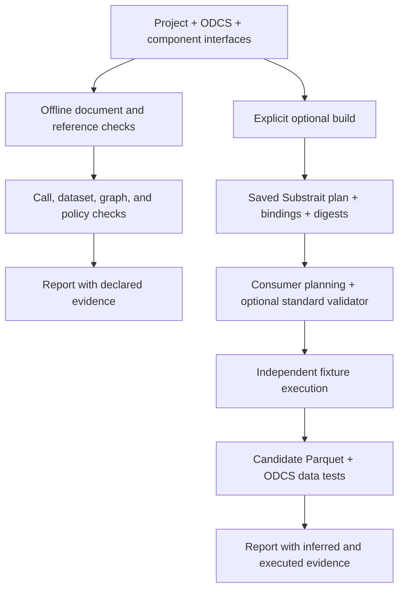
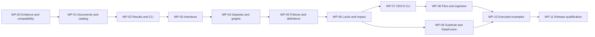

# Data Design Kit — Implementation Plan

**Plan date: November 4, 2026. Status: proposed implementation; no runtime work package is complete.**

## 1. Delivery decision

Build an independently authored Python tool for checking reusable data designs. Ship an engine-independent checker first, followed by impact analysis and optional adapters. Use ODCS and JSON Schema as the authoritative vocabularies. Treat Substrait as a generated calculation artifact, with DataFusion as the first producer/consumer candidate.

The first useful user outcome is a library maintainer changing one reader interface and getting precise feedback for its loaded consumers before implementations or databases exist. The first integration demonstration adds known-result tests and actual-output validation to that same project.

This plan implements the [engineering specification](specification.md). It is informative planning material. Requirement IDs refer to normative specification anchors. The [work-package registry](../implementation/work-packages.json) and [conformance cases](../conformance/cases.json) provide machine-checkable traceability.

## 2. Current deliverables and remaining work

| Present in this repository | Still to implement |
| --- | --- |
| Draft normative specification and adapter boundaries | DDK parsing, checking, and reporting runtime |
| JSON Schemas for proposed document shapes | Symbolic containment and declared dataset compatibility |
| Independently authored commerce declarations and fixtures | Impact analysis and lock enforcement |
| Requirement-to-work-package and case traceability | Native-tool adapters and saved-plan execution |
| Pinned ODCS upstream schemas and source provenance | Runtime conformance, package installation, performance measurements |
| GitHub default-branch and selected pull-request research | Actual builds/tests of candidate upstream commit combinations |
| Delivery verification record; verification tools retained outside the repository | A published package, hosted repository, or production deployment |

Document and schema checks verify these deliverables only. They do not mark any future runtime conformance case as passed.

## 3. Implementation architecture

Use Python 3.12 as the initial development baseline; add supported Python versions through tested release matrices. Start with the standard library, `jsonschema`, and `referencing` for the core. JSON is mandatory. Add optional YAML only with a parser configuration that meets the restricted YAML requirements.

| Planned module | Owns | Must remain outside it |
| --- | --- | --- |
| `src/ddk/documents.py` | Parsing, schemas, source pointers, immutable loaded documents | Network calls, implementation imports |
| `src/ddk/catalog.py` | Project namespaces, references, identity index, effective-definition provenance | Dataset-value assertions |
| `src/ddk/interfaces.py` | Named ports, parameter instances, bounded symbolic containment | SQL execution |
| `src/ddk/datasets.py` | Declared tabular relations and explicit mapping facts | Engine-specific coercion defaults |
| `src/ddk/designs.py` | Indexed dependencies, cycles, exports, prerequisite blocking | Scheduling production jobs |
| `src/ddk/policies.py` | The four core policy rules and their results | A second quality-rule execution language |
| `src/ddk/impact.py` | Base/candidate differences and affected consumer paths | Implicit repository discovery |
| `src/ddk/inventory.py` | Input digests, locks, cache validity, execution receipts | Credentials or mutable global caches |
| `src/ddk/results.py` | Typed outcomes, decision reduction, diagnostics, serialization | Adapter-specific interpretation |
| `src/ddk/cli.py` | Commands, arguments, stream discipline, exit codes | Validation policy duplicated from modules |
| `src/ddk/adapters/` | Explicit optional integrations behind the manifest boundary | Imports during core discovery |

The table is a starting ownership map, not a requirement to create empty abstraction layers. Keep check results and loaded artifacts as simple typed records. Add an interface only when a concrete adapter or responsibility requires one. Reuse validated records instead of reparsing documents in every validator.

### 3.1 Data movement

Native ingestion jobs call dlt and produce a staged-snapshot receipt. DDK validates that receipt and its bindings; it does not need to become the production scheduler. Frictionless validates selected incoming files at the file boundary. Reuse per-run evidence only when all relevant inputs and semantics match.

### 3.2 Error flow

Each check consumes validated prerequisites and returns a typed result. A failed prerequisite makes dependent instances `not_run`, with the original failure retained. The final reducer owns the decision and exit code. Human rendering is a view over those records. Severity filters never determine correctness.

## 4. Dependency order and milestones

| Milestone | Outcome | Exit gate |
| --- | --- | --- |
| M0 | Public-source baseline and tested dependency candidates | Version-tuple experiment evidence, or explicit unsupported capabilities |
| M1 | Offline library checking, WP-01 through WP-05 | All core cases pass; no runtime adapter installed or imported |
| M2 | Shared-interface change workflow, WP-06 | Base/candidate impact paths, lock changes, unknown containment cases |
| M3 | Native file/ingestion/output validation, WP-07 and WP-08 | Exact staged snapshot linked to native reports; mapping losses visible |
| M4 | Saved-plan generation and checking, WP-09 | One supported plan compiles and is consumed; inference compared with ODCS |
| M5 | Reproducible execution demonstration, WP-10 | Independently expected fixture outputs; portability claimed only if demonstrated |
| M6 | Scoped release, WP-11 | Conformance report, dependency notices, reproducible artifacts, measured limits |

A core release can precede optional Substrait conformance. A combined release must still identify which optional checks are incomplete. No milestone relies on an upstream pull request merging on a particular date.

## 5. Work packages

### WP-00 — Public-source baseline and compatibility experiment

**Dependencies:** none. **Primary owner:** implementation lead. **Output:** pinned evidence and candidate dependency environments.

1. Review `PROVENANCE.md`; establish a new source tree and independent fixtures. Keep restricted predecessor material out of the repository and test corpus.
2. Confirm licenses from the exact public commits or distributions selected, including required notices and transitive dependencies.
3. Review both published versions and GitHub development. Use `github-snapshot.json` and `github-evidence.json` as the initial dated leads, not proof of current runtime behavior.
4. Build the Substrait validator from commit `157c13913ac2e95786d86e75558d4967eabff662` in an isolated environment, and compare it with the released validator. Its development manifests use 0.88.1 packaging; open PRs 562 and 554 propose 0.106.0. Treat those PRs as separate experimental candidates, never silently as supported main.
5. Inspect DataFusion Python's committed `Cargo.lock` and encoded plan headers. The observed Rust crate version `substrait 0.63.0` is not itself a Substrait specification version. Extract the actual format and extension identifiers rather than equating package version numbers.
6. Produce and consume a minimal read/filter/aggregate plan. Try the standalone validator on the same saved bytes. Record unsupported relations, function identifiers, packaging/build failures, and validator unknowns.
7. Evaluate DuckDB's GitHub extension and dialect declaration as the second-engine candidate. Compare its actual supported extension set with the producer's plan.
8. Run targeted native-tool regressions from the GitHub findings: definition constraint inheritance, ODCS combined operators, Frictionless composite keys/error inventory, and dlt nested Parquet as a future-profile probe.

**Acceptance:** an evidence matrix identifies exact commits, built distributions, hashes, operation coverage, and observed statuses. A compatible standard validator is either demonstrated or explicitly unavailable. The outcome may narrow optional profiles; it must not delay implementing a useful offline core.

**Stop condition:** after testing the selected released and development candidates, document unresolved incompatibility and disable the unsupported claim. Do not build a new Substrait validator to rescue the schedule.

### WP-01 — Strict documents, source locations, and catalog

**Dependencies:** WP-00 baseline. **Output:** parsed artifacts with stable identity and namespace resolution.

- Implement JSON parsing that rejects duplicate keys, non-finite values, and invalid UTF-8. Preserve exact bytes for digests and JSON Pointers for locations.
- Register the draft schemas and pinned ODCS revision in an offline `referencing` registry. Separate Draft 2020-12 validation from the ODCS schema's Draft 2019-09 dialect.
- Validate document shape before constructing typed records. Preserve unknown optional extensions without interpreting them.
- Implement namespace-scoped paths, imported-project traversal, permitted-root checks, dataset-object selection, and identity conflicts.
- Make limits configurable and preserve partial diagnostics on limit exhaustion.
- Optionally add restricted YAML after JSON behavior is stable. Do not use a parser's default YAML 1.1 boolean or date conversions.

**Acceptance:** all document and reference cases pass, including two imported projects that reuse the alias `orders`, a root-relative reference, a symlink escape, duplicate keys, invalid fragments, and same-version conflicting content. A core import must not load a reader, engine, or network client.

### WP-02 — Results, decisions, CLI, and capability discovery

**Dependencies:** WP-01. **Output:** complete machine-readable results and stable command behavior.

- Implement result and diagnostic records from the report schema.
- Implement one decision reducer for operational errors, required failures, incomplete required checks, and passing selected coverage.
- Build check-instance inventories before optional dispatch, including missing adapters.
- Add the proposed CLI command skeleton with correct argument errors, output streams, explicit side-effect boundaries, and atomic writes.
- Discover optional adapter manifests as data. Load executable implementations only for explicitly selected profiles.
- Exercise every decision combination, display filter, and machine-output path with meaningful CLI tests.

**Acceptance:** JSON output is one parseable report; output filters never change exit status; required missing adapters return 2; invalid documents return 1; unreadable required inputs return 3. Placeholder adapter code must return not-run rather than fabricated success.

### WP-03 — Component interfaces and bounded parameter reasoning

**Dependencies:** WP-02. **Output:** implementation-free checks for named calls and arguments.

- Validate object parameter schemas and tagged literal/reference arguments.
- Validate complete literal argument objects using upstream JSON Schema behavior, including cross-property constraints.
- Implement the documented primitive containment subset using exact numeric bounds and explicit boolean handling.
- Return unknown for unsupported schema reasoning; add per-property and whole-object instances so correlated constraints remain visible.
- Check named inputs and outputs while retaining related declaration locations.
- Keep component implementation references opaque during core validation.

**Acceptance:** a shared reader interface can be checked with no module present. The same call engine handles readers and transformations. Missing required arguments, unknown arguments, literal objects containing reserved-looking text, symbolic enums and bounds, and unsupported conditional schemas all have explicit expected results.

### WP-04 — Dataset compatibility, design graphs, and exports

**Dependencies:** WP-03. **Output:** declared input/output relationships for flat ODCS datasets.

- Normalize the selected ODCS object into field records without changing original source values or order.
- Implement field presence, logical scalar relationships, required/nullability behavior, and enum-value containment.
- Record declared uniqueness and row identity as assumptions. Do not infer join cardinality from column names.
- Build indexed step relationships; use deterministic topological ordering and detect self-cycles and larger cycles.
- Check every named export, including direct source exports and multiple component outputs.
- Represent unsupported nested or physical-type requirements as unknown, even when the ODCS document itself is valid.

**Acceptance:** multiple independent exports are all checked. An absent column fails even when ODCS `required` is false. Boolean-to-number is rejected. Extra-field behavior differs explicitly between input ports and exports. Positional execution mappings remain separate from logical name comparison.

### WP-05 — Shared definitions, project policies, and provenance

**Dependencies:** WP-04. **Output:** cross-document policy checks and definition-use inventory.

- Integrate the supported local ODCS definition resolver. Pin the resolver implementation and test its merge behavior rather than reimplementing loosely documented precedence.
- Track definition chains and key-level overrides. The GitHub CLI correction in PR 1812 must have an independent local regression.
- Implement fields-exist, row-identity, quality-fields, and vocabulary rules as small typed checks.
- Inventory unused registered definitions, including definitions carrying quality arrays.
- Preserve SQL and custom rules as declarations. Complete quality dependency metadata can be checked; undeclared SQL dependencies remain unknown.
- Reserve optional CUE integration until actual cross-field policy needs justify another language and runtime dependency.

**Acceptance:** changing one shared property or its quality declaration affects the right loaded consumers. Inline constraints do not silently lose inherited constraints in the chosen resolver tuple. A misleading primary-key claim is never promoted into observed uniqueness.

### WP-06 — Locks, dependency-aware impact, and non-weakening

**Dependencies:** WP-05. **Output:** reproducible checks and the principal shared-library maintenance workflow.

- Generate locks from actual source bytes and every followed local reference. Record distribution hashes and source commits for development builds, even if their package version matches a released version.
- Verify locked runs before using caches. Detect a changed transitive definition and a changed resolver or schema revision.
- Compare explicit base and candidate catalogs by identity. Separate content changes, declared version changes, and optionally formatting-only differences.
- Compute affected consumers using the union of base and candidate dependency relationships; removed edges must not hide former consumers.
- Revalidate candidate calls and report paths from changed declarations to affected consumers.
- Apply supported acceptance-direction and output-direction containment. Return unknown for unsupported non-weakening questions.

**Acceptance:** the independent reader-change scenario identifies all loaded consumers and distinguishes affected from broken. Same-version content changes fail the appropriate check. Cross-repository scope is explicit. Cached evidence changes when any relevant dependency changes.

### WP-07 — Data Contract CLI integration

**Dependencies:** WP-06. **Output:** native ODCS lint, version comparison, and actual-data results.

- Prefer a stable public API when sufficient; otherwise use a structured subprocess invocation with captured native evidence.
- Pin and compare the published CLI with GitHub commit `34b12923e0366fa4004c2f90644da41769699e0f`, which includes the inherited-constraint correction.
- Verify which schema revision the CLI actually uses. Distinguish its native lint result from DDK's pinned-schema result if they differ.
- Preserve producer/consumer perspective for version changes.
- Test final local Parquet or DuckDB output through the supported native backend and preserve unsupported quality-rule outcomes.
- Evaluate open PRs 1725 and 1726 for exact extra-field/order requirements before considering any duplicate runtime implementation in DDK.

**Acceptance:** native lint/data/version results translate faithfully into DDK evidence. A backend that cannot execute a requested rule does not produce a passed result. No credentials or production location are required for the local conformance example.

### WP-08 — Frictionless files and dlt staging

**Dependencies:** WP-07. **Output:** validated file intake and exact staged-snapshot receipts.

- Translate the supported ODCS subset to explicit Table Schema descriptors. Report missing-value, nullability, enum, uniqueness, and physical-type coverage separately.
- Exercise Frictionless's full selected check inventory, including error paths involving misconfigured checks. Open PR 1867 is a specific regression lead.
- Verify composite unique-key behavior under the exact selected commit. Open PR 1827 documents why accepting a descriptor is insufficient evidence of executing that requirement.
- Configure dlt field hints and schema-evolution policy independently. Use local fixture sources and the filesystem/Parquet destination first.
- Record normalization/name mappings, system columns, load identifiers, explicit file lists, and discarded counts when applicable.
- Keep nested Parquet claims disabled until the selected dlt version passes the relevant case; PR 4299 is a future-profile lead.

**Acceptance:** malformed input fails before normal ingestion. A new field under a frozen policy fails in the intended stage. The downstream binder uses exactly the staged files in the receipt. Mapping unsupportedness is visible instead of silently widening the schema.

### WP-09 — Substrait plans and DataFusion

**Dependencies:** WP-06 and WP-00 compatibility evidence. **Output:** one supported, inspectable saved-plan path.

- Start with a transform component implemented by a DataFusion SQL file and flat, explicitly mapped input schemas. Readers remain outside the calculation plan.
- Build an empty-schema planning context, compile the SQL, and save binary plan bytes plus an upstream-generated JSON view. Verify that this operation reads no production rows.
- Bind logical named inputs to fixtures or the exact staging snapshot. Re-import saved bytes through the consumer before deriving output schema.
- Compare names, nullability, logical/physical types, and ordering maps with the expected ODCS object under an explicit mapping profile.
- Run the standalone validator only for tuples that WP-00 demonstrated. Preserve unknown validity; avoid silent schema conversions.
- Import upstream dialect declarations where available as capability inputs, then confirm advertised support with independent tests.
- Build an atomic bundle with plans, logical bindings, document digests, mapping coverage, and a clear list of unfulfilled obligations.

**Acceptance:** a read/filter/join/aggregate example can be produced, saved, consumed, and compared. Compilation, consumer planning, standard validation, and output comparison have separate results. Unsupported custom functions or missing implementations do not disappear from coverage.

### WP-10 — Fixture tests, native output checks, and portability

**Dependencies:** WP-08 and WP-09. **Output:** one reproducible end-to-end demonstration and scoped engine comparison.

- Use pytest to load independently specified cases, invoke the saved plan, and compare unordered multisets by default.
- Include duplicate input keys, unmatched joins, null values, empty input, integer money arithmetic, date boundaries, and explicit type errors.
- Verify each engine against expected business results; compare engines only after those checks.
- Run native ODCS output checks on the candidate snapshot. Record evidence once and reuse it only with identical input and tool fingerprints.
- Add DuckDB's Substrait extension as a second engine after its tuple passes the selected operations. Leave portability unknown or unavailable if it does not.
- Cancel interrupted tests, keep bounded failure evidence, and clean only temporary data owned by the runner.

**Acceptance:** actual fixture totals match the authored expectations; repeated rows remain significant; original SQL cannot substitute for consuming the saved plan; wrong-but-well-typed joins fail result tests. A report can show core passed while an explicitly required portability check remains incomplete.

### WP-11 — Release qualification and handoff

**Dependencies:** WP-10 for a combined release; a core-only release can qualify its completed subset earlier. **Output:** reproducible package and scoped conformance statement.

- Package optional adapters separately from the offline core and verify a clean core-only installation.
- Run conformance and CLI tests across supported Python versions and platforms. Test paths outside the source checkout.
- Publish a profile and capability matrix, dependency lock, upstream commit references, notices, and software bill of materials.
- Measure representative project loading, change impact, memory, and cache behavior. Preserve failure evidence and investigate repeated scans.
- Update documentation status so future capabilities cannot be mistaken for implemented behavior.
- Require an explicit owner-controlled publication workflow; no deployment follows automatically from a passing local report.

**Acceptance:** a user can install the released core, check the representative library offline, reproduce its change-impact report, and inspect complete validation coverage. Optional runtime claims match retained evidence exactly.

## 6. First integration example

### Inputs

- Orders with `order_id`, `customer_id`, `order_day`, `amount_cents`, and `status`.
- Customers with `customer_id` and `region`.
- A shared orders reader with a typed `year` argument.
- A shared amount property definition carrying a quality declaration.

### Calculation

Filter cancelled orders, join customer regions, and sum integer cents by day and region. The specification does not silently choose a missing-customer or duplicate-customer policy: the example explicitly excludes unmatched orders through an inner join and includes duplicate-customer cases to reveal multiplication. Business expectations are authored before any implementation is run.

### Required exercises

1. Check all designs before implementations exist.
2. Change the reader's required parameter name and type; report affected consumers.
3. Introduce a missing step and a wrong export definition; preserve both errors.
4. Change an inherited quality dependency; identify the affected property consumers.
5. Build and execute the supported calculation from saved plan bytes.
6. Validate the candidate output against ODCS.
7. Require an unsupported check and verify that the overall result becomes incomplete.

## 7. Test strategy and evidence

| Layer | Expected evidence |
| --- | --- |
| Document artifacts | JSON Schema validation, local links, requirement IDs, vendor hashes |
| Core behavior | Independent positive, negative, and unknown cases for each requirement family |
| Compatibility reasoning | Boundary cases and property-based generation checked against finite enumerations where possible |
| Native adapters | Fixture outcomes plus native reports for the pinned version/commit |
| Saved plans | Plan digests, producer/consumer versions, extension identifiers, output inference |
| Business results | Expected rows authored independently of calculation code |
| Portability | Each engine matches expectations on the same plan and input snapshot |
| Release | Complete requested-coverage inventory, clean installation, retained reproducibility evidence |

Property-based tests are useful for containment boundaries, alias resolution, result reduction, and duplicate-preserving comparisons. They supplement named regressions. They do not replace independently expected outputs or expand claims beyond the supported semantics.

## 8. Performance and resource acceptance

These are proposed engineering targets, not measured results. Establish a named reference machine and dataset before accepting numerical limits.

- Generate a public synthetic design library with 1,000 artifacts, 10,000 step relationships, shared definitions, and several changed interfaces.
- Initial target: a cold offline core check within 5 seconds and 256 MiB peak resident memory on the reference machine; report parsing/schema/reference time separately.
- Initial target: a warm impact run checks the affected closure without revalidating unrelated unchanged artifacts. Report cache hits and invalidations, not just elapsed time.
- Verify each input file is parsed once per byte identity and that reports do not require copying staged datasets.
- Test cancellation, per-document limits, oversized graphs, and bounded adapter logs. Publish failures and revise the target with evidence if needed.

## 9. Risks, responses, and decision gates

| Risk | Evidence or trigger | Bounded response |
| --- | --- | --- |
| Unreleased upstream fixes are needed | GitHub research identifies concrete correctness changes | Pin a reviewed commit for an experimental lane; require tests and distribution hashes; keep published baseline comparison |
| Substrait producer/validator/consumer versions diverge | Released and GitHub manifests differ | Prove a tuple, narrow operations, or ship the optional check as unavailable |
| A package version hides source differences | Validator development package still uses version 0.1.4 | Record commit and built-artifact digest, not version alone |
| Schema revision changes under the same ODCS API version | Combined-operator correction on development branch | Pin the schema bytes and revision in conformance claims and locks |
| Generic schema compatibility becomes a research project | Unsupported conditions and nested constraints | Keep a sound subset and explicit unknown outcomes |
| Tool combinations duplicate state or policy | Repeated mapping rules or whole-dataset scans | Assign one owner per rule; generate bounded configurations and reuse valid evidence |
| The new interface format grows into another ecosystem | New field/type/quality/operator syntax appears | Keep those vocabularies in ODCS, JSON Schema, and Substrait; justify every new composition field |
| A beautiful checker misses real user work | Representative library still needs substantial manual checking | Compare task completion and maintenance code before expanding the format |

## 10. Decisions intentionally deferred

- Public package and executable name availability.
- Hosted registry, remote dependency fetching, and organization-wide discovery.
- Generic reusable quality-set templating beyond ODCS property definitions.
- Nested-table compatibility, generic SQL dependency inference, and arbitrary schema containment.
- CUE policy execution and non-Python implementations.
- Production scheduling, deployment, automatic publication, and credential management services.

These deferrals do not weaken declared conformance requirements. A requested deferred capability must remain unknown or not-run. They prevent a first implementation from becoming a replacement for all of its dependencies.

## 11. Requirement coverage

Every normative requirement is assigned to a primary work package in [work-packages.json](../implementation/work-packages.json). Individual conformance cases name their requirement IDs. Documentation checks verify that all referenced IDs exist and every requirement has an owner and at least one future case. The runtime implementation must turn those cases into executed evidence before making claims.
