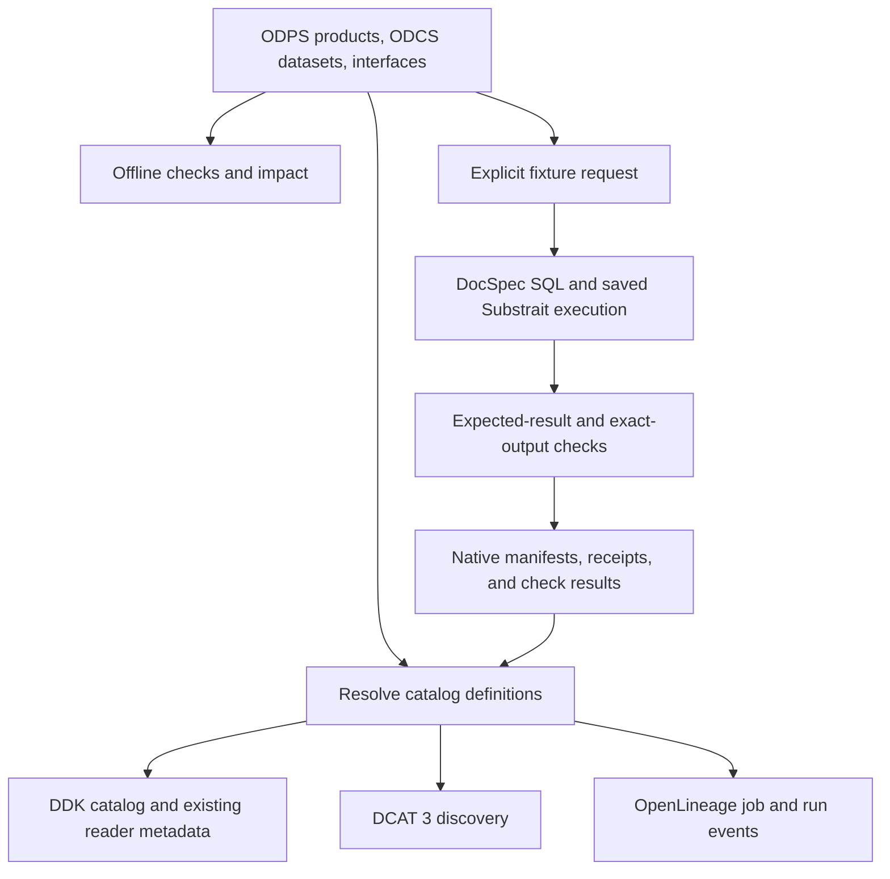
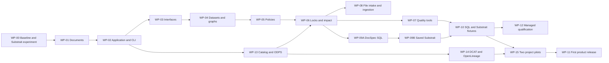

# Data Design Kit — Implementation Plan

**Plan date: November 5, 2026. Status: proposed implementation; no runtime work package is complete.**

## 1. Delivery decision

Build an independently authored Python checker and catalog generator. Use one set of maintained definitions for catalog discovery, interface checks, transformation tests, and downstream impact. Attach observed versions, releases, runs, and check results from their native owners.

The first DDK product release includes ODPS product definitions, ODCS dataset definitions, DCAT 3 discovery, OpenLineage job and run records, and saved Substrait execution through DocSpec. It also qualifies SQL execution, independently specified fixtures, and supported ODCS checks. The offline checker remains independently installable and usable. Data Contract CLI, Frictionless, dlt, pytest, and the DocSpec profiles retain distinct capability boundaries.

The first useful workflow resolves one product into a catalog with an exact version and checked query. Release acceptance extends it to both pilots in WP-15. This plan implements the [engineering specification](specification.md). The [work-package registry](../implementation/work-packages.json) and [conformance cases](../conformance/cases.json) track the normative requirements.

## 2. Current deliverables and remaining work

| Present in this repository | Still to implement |
| --- | --- |
| Draft normative specification and adapter boundaries | DDK parsing, checking, and reporting runtime |
| JSON Schemas for proposed document shapes and a catalog example | Catalog assembly, symbolic containment, and declared dataset compatibility |
| Independently authored commerce declarations and fixtures | Impact analysis and lock enforcement |
| Requirement-to-work-package and case traceability | Native-tool adapters and saved-plan execution |
| Pinned ODCS, ODPS, and OpenLineage schemas and source provenance | Runtime conformance, package installation, performance measurements |
| GitHub default-branch and selected pull-request research | Actual builds/tests of candidate upstream commit combinations |
| Delivery verification record; verification tools retained outside the repository | A published package, hosted repository, or production deployment |

Document and schema checks verify these deliverables only. They do not mark any future runtime conformance case as passed.

## 3. Implementation architecture

Use Python 3.12 as the initial development baseline; add supported Python versions through tested release matrices. Start with the standard library, `jsonschema`, and `referencing` for the core. JSON is mandatory. Add optional YAML only with a parser configuration that meets the restricted YAML requirements.

| Planned boundary | Owns | Must remain outside it |
| --- | --- | --- |
| Domain: products, datasets, designs, policies, impact, results | Typed declarations, scoped relationships, exact references, compatibility rules, result reduction | Native implementation types, runtime selection, transport |
| Application: project checks, catalog assembly, impact, preparation, tests | Resolve definitions, connect native evidence, and generate requested outputs | Native lifecycle state, retention or selection authority |
| Document and catalog adapters | Parsing, local native metadata, pinned schemas, DCAT and OpenLineage mapping, and reader outputs | Runtime imports and network resolution during core checks |
| Execution and quality adapters | DocSpec/native-tool mapping, structured transport, evidence translation | Duplicated domain policy or native durable phases |
| CLI and composition root | Arguments, output, explicit service construction | Compatibility logic and ambient adapter activation |

Use simple typed records and explicit constructor/function arguments. Domain/application boundaries are required; empty package hierarchies and generic dependency containers are not. A CLI composition root and a library composition root may inject the same adapters. Core invokes neither a runtime nor quality service.

The initial execution use cases justify `PlanService`, `JobExecutor`, and `QualityEvaluator`. Add `DatasetRuntime` with the first managed workflow. One DocSpec adapter may implement multiple ports. Begin with structured subprocess requests/responses; add only missing DocSpec preparation and receipt support. A server or Python binding needs a demonstrated additional use case. The [runtime integration design](runtime-integration.md) specifies inputs, outputs, checks, and ownership.

### 3.1 Data movement

Ordinary catalog builds read metadata. A requested fixture test reads its pinned inputs and executes in an isolated local context. Frictionless checks a selected file boundary, and dlt supplies staging receipts for configured ingestion workflows. DocSpec resolves native versions and preserves their schema and field identity. Production publishers supply selected release records.

Implementation declarations identify format, dialect, and semantics. Bindings select the runtime, execution mode, connections, and limits. Retain native computation and qualification keys separately from full provenance. Reuse qualifying evidence only when its target, rule, evaluator, scope, and custody assumptions still apply.

### 3.2 Error flow

Each check consumes validated prerequisites and returns a typed result. A failed prerequisite makes dependent instances `not_run`, with the original failure retained. The final reducer owns the decision and exit code. Human rendering is a view over those records. Severity filters never determine correctness. Runtime execution and selection have separate outcomes. A timeout can make report completion an operational error while native work remains unknown or continues. Preserve the original managed operation ID and reconcile through DocSpec; never create a replacement automatically. Returned bounded-job partial outputs do not imply durable process-loss recovery.

## 4. Dependency order and milestones

| Milestone | Useful outcome | Exit evidence |
| --- | --- | --- |
| M0 | Pin standards and test saved-plan compatibility | Exact source and dependency identities, supported operations, separate validation and execution results |
| M1 | Resolve product definitions and generate a usable local catalog | ODPS ports resolve to ODCS objects, known exact versions and relationships appear with source references |
| M2 | Generate standard discovery and lineage | Independent DCAT reader resolves access, OpenLineage separates definitions and observations |
| M3 | Check changes and execute bounded fixtures | Correct impact paths, SQL and saved Substrait produce independently expected results, ODCS checks bind to exact output |
| M4 | Demonstrate both pilot products | Correct queries, source trace, native selections, metadata reuse, and consolidated authoring |
| Release | Qualify the complete first product | Required profiles pass with retained evidence, reproducible installs, pinned dependencies, and explicit limits |

WP-11 requires the first release profiles listed in DDK-VERSION-003. WP-08 and WP-12 qualify the separate intake and managed-selection profiles. The standalone validator and each additional runtime receive separate capability claims. Local development builds can exercise subsets while the release work is in progress.

## 5. Work packages

### WP-00 — Public-source baseline and compatibility experiment

**Dependencies:** none. **Primary owner:** implementation lead with DDK and DocSpec maintainers. **Output:** pinned source evidence and bounded compatibility decisions. Baseline inventory unblocks core; optional experiments continue independently.

1. Review `PROVENANCE.md`; establish a new source tree and independent fixtures. Keep restricted predecessor material out of the repository and test corpus.
2. Confirm licenses from the exact public commits or distributions selected, including required notices and transitive dependencies.
3. Review both published versions and GitHub development. Use `github-snapshot.json` and `github-evidence.json` as dated leads, not proof of runtime behavior. Inspect the owned DocSpec revision in `docspec-evidence.json`; identify SQL preparation gaps, exact native reads, partial-failure behavior, operation/backend limits, and retained computation/validation mechanisms. Test whether the selected CLI backend can read an exact unselected candidate without an unnecessary export.
4. For the standalone validator profile, build the Substrait validator from commit `157c13913ac2e95786d86e75558d4967eabff662` in an isolated environment, and compare it with the released validator. Its development manifests use 0.88.1 packaging; open PRs 562 and 554 propose 0.106.0. Treat those PRs as separate experimental candidates, never silently as supported main.
5. Choose a tested Rust DataFusion baseline inside DocSpec, using the inspected 53.1.0 pin as a starting point. It may change. Treat the earlier Python snapshot as a separate research candidate, not a second mandatory DDK runtime. Inspect encoded plan headers and extensions; crate versions are not specification versions.
6. Produce and consume a minimal read/filter/aggregate plan. Try the standalone validator on the same saved bytes. Record unsupported relations, function identifiers, packaging/build failures, and validator unknowns.
7. Evaluate DuckDB's GitHub extension and dialect declaration as the second-engine candidate. Compare its actual supported extension set with the producer's plan.
8. Run targeted native-tool regressions from the GitHub findings: definition constraint inheritance, ODCS combined operators, Frictionless composite keys/error inventory, and dlt nested Parquet as a future-profile probe.

**Acceptance:** an evidence matrix identifies exact commits, built distributions, hashes, operation coverage, and observed statuses. Pin the ODPS and OpenLineage schemas and validate a DCAT 3 graph with an independent reader. A compatible standard validator is either demonstrated or explicitly unavailable. Use the compatibility experiment to narrow the first release plan profile to a supported operation set. Offline checker work can proceed in parallel.

**Decision gate:** record unsupported combinations and test a narrower supported plan when needed. The first product release requires one qualified saved-plan execution path. Standalone validation coverage follows its separate evidence.

### WP-01 — Strict documents, source locations, and artifact index

**Dependencies:** WP-00 baseline. **Output:** parsed artifacts with stable identity and namespace resolution.

- Implement JSON parsing that rejects duplicate keys, non-finite values, and invalid UTF-8. Preserve exact bytes for digests and JSON Pointers for locations.
- Register the draft schemas and pinned ODCS revision in an offline `referencing` registry. Separate Draft 2020-12 validation from the ODCS schema's Draft 2019-09 dialect.
- Validate document shape before constructing typed records. Preserve unknown optional extensions without interpreting them.
- Implement namespace-scoped paths, imported-project traversal, permitted-root checks, dataset-object selection, and identity conflicts.
- Make limits configurable and preserve partial diagnostics on limit exhaustion.
- Optionally add restricted YAML after JSON behavior is stable. Do not use a parser's default YAML 1.1 boolean or date conversions.

**Acceptance:** all document and reference cases pass, including two imported projects that reuse the alias `orders`, a root-relative reference, a symlink escape, duplicate keys, invalid fragments, and same-version conflicting content. A core import must not load a reader, engine, or network client.

### WP-02 — Results, decisions, CLI, and capability discovery

**Dependencies:** WP-01. **Output:** complete machine-readable results and stable command behavior.

- Implement result and diagnostic records from the report schema, including independent runtime execution/selection outcomes. Add the application use cases and explicit composition-root injection; domain tests must not import native implementation types.
- Implement one decision reducer for operational errors, required failures, incomplete required checks, and passing selected coverage.
- Build check-instance inventories before optional dispatch, including missing adapters.
- Add the proposed CLI command skeleton, including `catalog`, with correct argument errors, output streams, explicit side-effect boundaries, and atomic writes.
- Discover optional adapter manifests as data. Load executable implementations only for explicitly selected profiles.
- Exercise every decision combination, display filter, and machine-output path with meaningful CLI tests.

**Acceptance:** JSON output is one parseable report; output filters never change exit status; required missing adapters return 2; invalid documents return 1; unreadable required inputs return 3. Placeholder adapter code must return not-run rather than fabricated success.

### WP-03 — Component interfaces and bounded parameter reasoning

**Dependencies:** WP-02. **Output:** implementation-free checks for named calls and arguments.

- Validate object parameter schemas and tagged literal/reference arguments.
- Validate complete literal argument objects using upstream JSON Schema behavior, including cross-property constraints.
- Implement the documented primitive containment subset using exact numeric bounds and explicit boolean handling.
- Return unknown for unsupported schema reasoning; add per-property and whole-object instances so correlated constraints remain visible.
- Check named inputs and outputs while retaining related declaration locations.
- Validate artifact format, dialect, and semantic-profile declarations while keeping implementations opaque during core validation. Keep runtime placement and limits in binding/caller settings.

**Acceptance:** a shared reader interface can be checked with no module present. The same call engine handles readers and transformations. Missing required arguments, unknown arguments, literal objects containing reserved-looking text, symbolic enums and bounds, and unsupported conditional schemas all have explicit expected results.

### WP-04 — Dataset compatibility, design graphs, and exports

**Dependencies:** WP-03. **Output:** declared input/output relationships for flat ODCS datasets.

- Normalize the selected ODCS object into field records without changing original source values or order.
- Implement field presence, logical scalar relationships, required/nullability behavior, and enum-value containment.
- Record declared uniqueness and row identity as assumptions. Do not infer join cardinality from column names.
- Build indexed step relationships; use deterministic topological ordering and detect self-cycles and larger cycles.
- Check every named export, including direct source exports and multiple component outputs.
- Represent unsupported nested or physical-type requirements as unknown, even when the ODCS document itself is valid.

**Acceptance:** multiple independent exports are all checked. An absent column fails even when ODCS `required` is false. Boolean-to-number is rejected. Extra-field behavior differs explicitly between input ports and exports. Positional execution mappings remain separate from logical name comparison.

### WP-05 — Shared definitions, project policies, and provenance

**Dependencies:** WP-04. **Output:** cross-document policy checks and definition-use inventory.

- Integrate the supported local ODCS definition resolver. Pin the resolver implementation and test its merge behavior rather than reimplementing loosely documented precedence.
- Track definition chains and key-level overrides. The GitHub CLI correction in PR 1812 must have an independent local regression.
- Implement fields-exist, row-identity, quality-fields, and vocabulary rules as small typed checks.
- Inventory unused registered definitions, including definitions carrying quality arrays.
- Preserve SQL and custom rules as declarations. Complete quality dependency metadata can be checked; undeclared SQL dependencies remain unknown.
- Reserve optional CUE integration until actual cross-field policy needs justify another language and runtime dependency.

**Acceptance:** changing one shared property or its quality declaration affects the right loaded consumers. Inline constraints do not silently lose inherited constraints in the chosen resolver tuple. A misleading primary-key claim is never promoted into observed uniqueness.

### WP-06 — Locks, dependency-aware impact, and non-weakening

**Dependencies:** WP-05 and WP-13. **Output:** reproducible checks and catalog-aware change analysis.

- Generate locks from actual source bytes and every followed local reference. Record distribution hashes and source commits for development builds, even if their package version matches a released version. Preserve native input references and runtime-issued computation/qualification keys independently from provenance; do not create a second native phase cache.
- Verify locked runs before using caches. Detect a changed transitive definition and a changed resolver or schema revision.
- Compare explicit base and candidate catalogs by identity. Separate content changes, declared version changes, and optionally formatting-only differences.
- Compute affected consumers using the union of base and candidate dependency relationships; removed edges must not hide former consumers.
- Revalidate candidate calls and report paths from changed declarations to affected consumers.
- Apply supported acceptance-direction and output-direction containment. Return unknown for unsupported non-weakening questions.

**Acceptance:** the independent reader-change scenario identifies all loaded consumers and distinguishes affected from broken. Same-version content changes fail the appropriate check. Cross-repository scope is explicit. Cached evidence changes when any relevant dependency changes.

### WP-07 — Data Contract CLI integration

**Dependencies:** WP-06. **Output:** native ODCS lint, version comparison, and actual-data results.

- Prefer a stable public API when sufficient; otherwise use a structured subprocess invocation with captured native evidence.
- Pin and compare the published CLI with GitHub commit `34b12923e0366fa4004c2f90644da41769699e0f`, which includes the inherited-constraint correction.
- Verify which schema revision the CLI actually uses. Distinguish its native lint result from DDK's pinned-schema result if they differ.
- Preserve producer/consumer perspective for version changes.
- Test final local Parquet or DuckDB output through the supported native backend and preserve unsupported quality-rule outcomes. Implement `QualityEvaluator` with exact dataset identity, resolved rules, required check inventory, evaluator identity, mapping semantics, and native evidence. Probe direct exact-candidate access separately; do not qualify a native gate from file-backed success.
- Evaluate open PRs 1725 and 1726 for exact extra-field/order requirements before considering any duplicate runtime implementation in DDK.

**Acceptance:** native lint/data/version results translate faithfully into DDK evidence. A backend that cannot execute a requested rule does not produce a passed result. No credentials or production location are required for the local conformance example.

### WP-08 — Frictionless files and dlt staging

**Dependencies:** WP-06. **Output:** validated file intake and exact staged-snapshot receipts. This can proceed independently of the SQL/quality demonstration.

- Translate the supported ODCS subset to explicit Table Schema descriptors. Report missing-value, nullability, enum, uniqueness, and physical-type coverage separately.
- Exercise Frictionless's full selected check inventory, including error paths involving misconfigured checks. Open PR 1867 is a specific regression lead.
- Verify composite unique-key behavior under the exact selected commit. Open PR 1827 documents why accepting a descriptor is insufficient evidence of executing that requirement.
- Configure dlt field hints and schema-evolution policy independently. Use local fixture sources and the filesystem/Parquet destination first.
- Record normalization/name mappings, system columns, load identifiers, explicit file lists, and discarded counts when applicable.
- Keep nested Parquet claims disabled until the selected dlt version passes the relevant case; PR 4299 is a future-profile lead.

**Acceptance:** malformed input fails before normal ingestion. A new field under a frozen policy fails in the intended stage. The downstream binder uses exactly the staged files in the receipt. Mapping unsupportedness is visible instead of silently widening the schema.

### WP-09A — DocSpec SQL preparation, jobs, and native bindings

**Dependencies:** WP-06 and WP-00 source baseline. **Owners:** DocSpec for runtime changes; DDK for application ports and translation. **Output:** one explicit, bounded SQL execution path.

- Reshape DocSpec's unreleased public API as needed to support schema-only preparation and machine-readable job receipts. Reuse its maintained DataFusion context, function/input checks, budgets, and native readers.
- Implement `PlanService` and `JobExecutor`; do not leak DataFusion frames, catalogs, or DocSpec domain types into DDK's domain.
- Start with one SQL component, flat schemas, named inputs, explicit parameter binding, and independently authored expected outputs. A Substrait intermediate is optional.
- Encode authored fixture rows as bounded, explicitly schematized JSON Lines for the existing DocSpec input path. Direct CSV execution is not established by current `JobSpec`; qualify an explicit conversion/read path or report it unsupported. Keep the commerce CSV intake example distinct from the first fixture execution.
- Support discriminated file/native bindings. Validate native references using their runtime scheme and preserve complete dataset interpretation, native field IDs, names/order/types, native digest algorithms, and protection lifetime.
- Return observed partial outputs on ordinary job failure. Distinguish process loss and unknown outcome from a known failure; do not advertise durable tracking for current ordinary jobs.
- Produce a bundle whose exports identify implementation format and semantics, with source inventories, exact bindings, generated jobs if any, mapping coverage, and unfulfilled obligations.

**Acceptance:** preparation reads no production rows; SQL fixtures run through DocSpec; exact native reads survive a change to latest; wrong algorithms, missing versions, and ambiguous group mappings are refused. A second-output failure preserves the first output's identity. Source byte hashes and native identities remain distinct. No DDK native phase store exists.

### WP-09B — Saved Substrait through DocSpec

**Dependencies:** WP-09A plus WP-00's selected tuple experiment. **Owners:** DocSpec for format/runtime support; DDK for capability and evidence mapping. **Output:** the first release saved-plan capability.

- Add a Substrait representation through the same admitted DocSpec context used for SQL; qualify any dependency/API changes together.
- Save binary bytes, encoded format version, extension definitions and algorithm-tagged digests, producer and consumer identities, and a readable upstream-generated view.
- Consume those bytes with exact named bindings before output inference or execution. Apply normalized-plan function/input restrictions and equivalent resource checks after decoding.
- Compare names, nullability, logical/physical types, and ordering with the expected ODCS object under the selected mapping profile.
- Run a compatible standalone validator separately. Preserve unknown validity, unsupported operations, and absent compatible validators.
- Add a second-engine experiment only after the selected tuple passes independent business expectations. Do not build a new validator or silently recompile SQL to rescue portability.

**Acceptance:** saved bytes support the selected read/filter/join/aggregate subset; unknown functions and unauthorized reads cannot bypass guards; memory/spill/concurrency limits remain applicable. Compilation, consumer planning, standard validity, output inference, and execution remain separate. Direct SQL tests and offline checks can run before this package completes. First product release acceptance requires it.

### WP-10 — Fixture tests, native output checks, and portability

**Dependencies:** WP-07, WP-09A, and WP-09B. **Output:** reproducible SQL and saved Substrait tests with exact-output quality evidence. WP-08 contributes optional file intake and ingestion cases.

- Use pytest to load independently specified cases, execute the identified SQL artifact through DocSpec, and compare unordered multisets by default. The required Substrait cases consume saved bytes and use the same independent expected rows as the SQL tests.
- Include duplicate input keys, unmatched joins, null values, empty input, integer money arithmetic, date boundaries, and explicit type errors.
- Verify each engine against expected business results; compare engines only after those checks.
- Run native ODCS output checks on the candidate snapshot. Record evidence once and reuse it only with identical input and tool fingerprints.
- Add DuckDB's Substrait extension as a second engine after its tuple passes the selected operations. Leave portability unknown or unavailable if it does not.
- Cancel the caller wait or request native cancellation as supported, preserve original native IDs and uncertain outcomes, retain bounded failure evidence, and clean only temporary data owned by the runner. Never remove native protected candidates through local fixture cleanup.

**Acceptance:** actual fixture totals match the authored expectations; repeated rows remain significant; wrong-but-well-typed joins fail result tests. The Substrait result is established by executing the saved plan. A report can show core passed while an explicitly required portability check remains incomplete.

### WP-11 — Release qualification and handoff

**Dependencies:** WP-06, WP-10, WP-14, and WP-15. **Output:** reproducible first product release with the complete DDK-VERSION-003 profile set. WP-08 and WP-12 qualify separate claims.

- Package the offline checker and adapters with explicit installation and invocation boundaries. Verify the core-only installation and the complete first release workflow.
- Run the required conformance and CLI cases across supported platforms. Test paths outside the source checkout.
- Publish the supported profiles, dependency lock, upstream references, notices, and software bill of materials.
- Retain independent results for ODPS resolution, DCAT access links, OpenLineage design and observed run records, SQL and saved Substrait execution, and output qualification.
- Measure representative loading, impact, and metadata refresh behavior. Record the reused evidence and payload reads.
- Use the owner-controlled release workflow after the acceptance evidence is complete.

**Acceptance:** a consumer can discover both pilot products, choose an exact data version, run a checked query, and see applicable evidence and limitations. Maintainers can reproduce the test and impact reports. Each profile claim names its tested dependency tuple.

### WP-12 — Managed candidates and accepted quality gates

**Dependencies:** WP-07, WP-09A, and WP-10; exact-native quality access must pass before a native quality-gate claim. **Owners:** DocSpec for lifecycle changes; DDK for `DatasetRuntime`, rule requests, and receipt translation. **Output:** one qualified managed operation/backend family.

- Choose a concrete existing typed operation family and backend. Arbitrary managed SQL and automatic incremental planning are separate future designs.
- Expose native prepare/inspect/accept-qualification/select/reconcile responsibilities while keeping one lifecycle, phase-reuse authority, protection inventory, and selection owner.
- Capture stable operation ID, request identity, required rule-set artifact, and policy preconditions before submission. Preserve them on timeout and cold restart.
- Retain candidates while the configured evaluator reads the exact protected version. Accept evidence only for matching candidate, complete rules, evaluator, semantics, and required-check coverage.
- Check accepted evidence with authority conditions in guarded selection, including each supported selection branch. Missing/unknown/failed required checks and wrong-candidate evidence cannot select.
- A changed qualification request may reuse native computed values. Keep computation keys, qualification keys, and full provenance distinct. Do not mutate the original request silently.
- Record accepted native qualification identity, known outputs, execution outcome, selection outcome, and reconciliation capability. Reconcile lost responses under the original native operation ID.

**Acceptance:** rule-only change performs no new computation; stale or incomplete qualification blocks selection; concurrent authority changes cannot select stale candidates; lost acknowledgment returns the original outcome without repeating completed work. File-backed quality results alone do not qualify native access. Report the managed profile as unqualified until exact-native evidence acceptance passes. Its release evidence is separate from bounded job evidence.

### WP-13 — Product catalog and native metadata

**Dependencies:** WP-02. **Owners:** DDK and project metadata owners. **Output:** ODPS-backed catalog and its exact input inventory.

- Resolve product ports to registered ODCS schema objects. Preserve the owning source document and digest. Validate the selected object when a port references a contract with several objects.
- Support native metadata adapters for selected versions, source occurrences, representations, runs, scoped checks, releases, and selections. Use scheme-qualified native identities. Retain record links and independent availability states.
- Check nested endpoint paths, composite keys, virtual row identities, relationship meaning, and query example references. Validate same-release scope before presenting a release-local relationship as usable.
- Generate a local catalog from explicit metadata inputs. Apply disclosure rules and inventory companion outputs. Test deterministic refresh and preserve complete prior artifacts if a requested output cannot be generated.

**Acceptance:** the catalog describes an exact dataset version and its supported access, known run and evidence, and selected release. A valid empty output, absent data, unknown coverage, and acquisition failure remain distinguishable. Tests reject an incorrect port binding and preserve an unknown qualification.

### WP-14 — DCAT and OpenLineage interchange

**Dependencies:** WP-13. **Owners:** DDK integration. **Output:** standards outputs generated from the same catalog definitions and native records.

- Emit DCAT 3 JSON-LD with stable dataset and version identifiers, available representations or services, and selection references where relevant. Check the graph using an independent reader.
- Emit OpenLineage `JobEvent` for the intended design and `RunEvent` for observed lifecycle records. Bind run and version identifiers to the catalog and native evidence. Validate events and supported facets against pinned schemas.
- Exercise a historical upstream binding when the current selection changes. Verify that an unresolved terminal outcome remains unresolved and that any design-only record is identified as such.

**Acceptance:** an independent reader can follow DCAT discovery to an exact advertised access path. Valid OpenLineage events distinguish design dependencies and actual inputs and outputs, with an exact run-reference mapping.

### WP-15 — Two product pilots and authoring migration

**Dependencies:** WP-06, WP-10, and WP-14. **Owners:** DDK, SpicyRegs/SpicyDocs, and congressional-tech maintainers. **Output:** two end-to-end adoption examples and an inventory of consolidated definitions.

| Pilot | User task | Authoring migration |
| --- | --- | --- |
| SpicyRegs Federal Register | Find the bounded source records and query parent/child or docket data with the complete dated key. Trace a value to its retained original and explain a conversion. | Select one maintained owner for each repeated relationship or field description. Generate dictionary and reader metadata, and retain scoped measurements as evidence. |
| Congressional documents and meetings | Find a transcript through its nested meeting reference and open it in the exact selected release. Follow published binary keys and pinned upstream dependencies. | Adapt the existing release registry as a source or migrate its owned facts once. Generate its consumer outputs and retire the corresponding duplicate maintained descriptions. |

- Use bounded retained inputs and version metadata. Record the actual local candidate status for Federal Register and the selected release binding for congressional data.
- Compare query results with independent expectations, including a wrong dated key and an attempted cross-release position join. Exercise a wrong input version, unresolved coverage, and missing required evidence.
- Show one maintained definition change in the catalog and existing consumer outputs. Record which maintained copies or reconciliation paths are retired.
- Compare the read inventory for first generation and unchanged refresh. Preserve exact input history when a publisher changes its selection.

**Acceptance:** the pilots meet DDK-TEST-004 and demonstrate useful discovery and queries, less duplicate authoring, exact lineage, and evidence reuse. Project publishers keep authority over their selections.

## 6. Commerce regression fixture

The independently authored commerce fixture exercises a shared reader, changed interfaces, inherited field requirements, invalid dependencies, and known revenue outputs. The fixture filters cancelled orders, joins customer regions, and sums integer cents by date and region. Execute the SQL and saved Substrait plan against the same expected rows. Run exact-output ODCS checks, and exercise a missing required check and wrong-but-well-typed join.

The [catalog example](../examples/commerce/catalog/README.md) adds ODPS, version and release metadata, DCAT, and OpenLineage document shapes. The two project pilots supply the first product acceptance evidence.

## 7. Test strategy and evidence

| Layer | Expected evidence |
| --- | --- |
| Document artifacts | JSON Schema validation, local links, requirement IDs, vendor hashes |
| Core behavior | Independent positive, negative, and unknown cases for each requirement family |
| Compatibility reasoning | Boundary cases and property-based generation checked against finite enumerations where possible |
| Native adapters | Fixture outcomes plus native reports for the pinned version/commit |
| Catalog and interchange | ODPS resolution, exact native references, independent DCAT reading, OpenLineage schema and identity checks |
| SQL jobs and native bindings | Schema-only inference, exact read views, native identities, partial failure, budgets |
| Managed quality gates | Candidate/rules/evaluator binding, accepted evidence, guarded selection, reuse and lost-response recovery |
| Saved plans | Plan digests, producer/consumer versions, extension identifiers, output inference |
| Business results | Expected rows authored independently of calculation code |
| Portability | Each engine matches expectations on the same plan and input snapshot |
| Release | Complete requested-coverage inventory, clean installation, retained reproducibility evidence |

Property-based tests are useful for containment boundaries, alias resolution, result reduction, and duplicate-preserving comparisons. They supplement named regressions. They do not replace independently expected outputs or expand claims beyond the supported semantics.

## 8. Performance and resource acceptance

These are proposed engineering targets, not measured results. Establish a named reference machine and dataset before accepting numerical limits.

- Generate a public synthetic design library with 1,000 artifacts, 10,000 step relationships, shared definitions, and several changed interfaces.
- Initial target: a cold offline core check within 5 seconds and 256 MiB peak resident memory on the reference machine; report parsing/schema/reference time separately.
- Initial target: a warm impact run checks the affected closure without revalidating unrelated unchanged artifacts. Report cache hits and invalidations, not just elapsed time.
- Verify each input file is parsed once per byte identity and that reports do not require copying staged datasets.
- Test cancellation, per-document limits, oversized graphs, and bounded adapter logs. Publish failures and revise the target with evidence if needed.

## 9. Risks, responses, and decision gates

| Risk | Evidence or trigger | Bounded response |
| --- | --- | --- |
| Unreleased upstream fixes are needed | GitHub research identifies concrete correctness changes | Pin a reviewed commit for an experimental lane; require tests and distribution hashes; keep published baseline comparison |
| Substrait producer/validator/consumer versions diverge | Released and GitHub manifests differ | Qualify one saved-plan producer and consumer combination early. Scope standalone validator and additional-engine claims separately |
| A package version hides source differences | Validator development package still uses version 0.1.4 | Record commit and built-artifact digest, not version alone |
| Schema revision changes under the same ODCS API version | Combined-operator correction on development branch | Pin the schema bytes and revision in conformance claims and locks |
| Generic schema compatibility becomes a research project | Unsupported conditions and nested constraints | Keep a sound subset and explicit unknown outcomes |
| Tool combinations duplicate state or policy | Repeated mapping rules or whole-dataset scans | Assign one owner per rule; generate bounded configurations and reuse valid evidence |
| The new interface format grows into another ecosystem | New field/type/quality/operator syntax appears | Keep those vocabularies in ODCS, JSON Schema, and Substrait; justify every new composition field |
| A beautiful checker misses real user work | Representative library still needs substantial manual checking | Compare task completion and maintenance code before expanding the format |

## 10. Decisions intentionally deferred

- Public package and executable name availability.
- Hosted registry, remote dependency fetching, and organization-wide discovery.
- Generic reusable quality-set templating beyond ODCS property definitions.
- General nested-schema compatibility reasoning, generic SQL dependency inference, and arbitrary schema containment. The first release preserves and validates supported nested references.
- CUE policy execution and non-Python implementations.
- Production scheduling, deployment, automatic publication, and credential management services.
- Arbitrary managed SQL, automatic incremental planning, broad backend coverage, and a general quality-rule framework.
- A server or Python binding without a concrete use case; speculative plugin systems and a universal calculation representation.

These deferrals do not weaken declared conformance requirements. A requested deferred capability must remain unknown or not-run. They prevent a first implementation from becoming a replacement for all of its dependencies.

## 11. Requirement coverage

Every normative requirement is assigned to a primary work package in [work-packages.json](../implementation/work-packages.json). Individual conformance cases name their requirement IDs. Documentation checks verify that all referenced IDs exist and every requirement has an owner and at least one future case. The runtime implementation must turn those cases into executed evidence before making claims.
